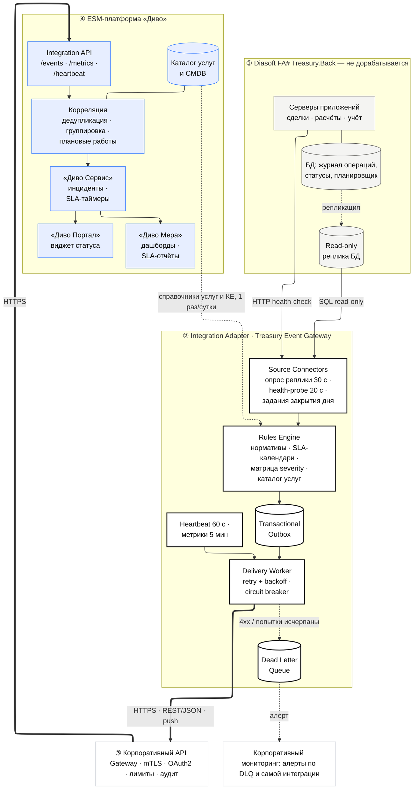
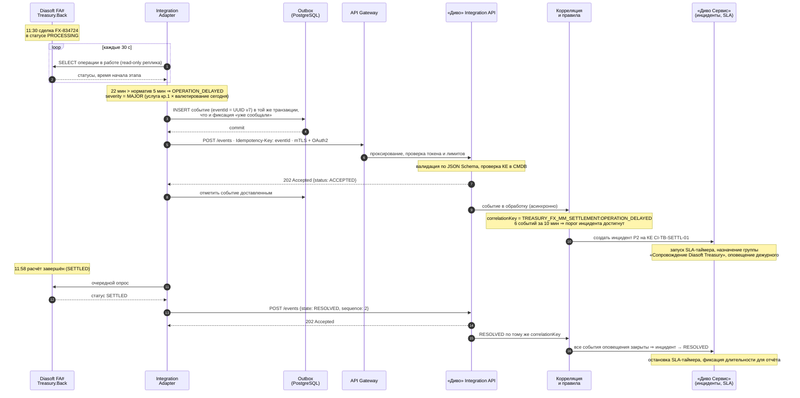
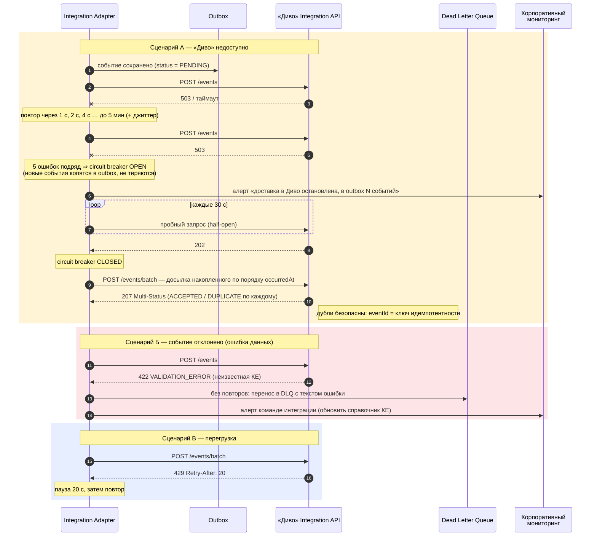
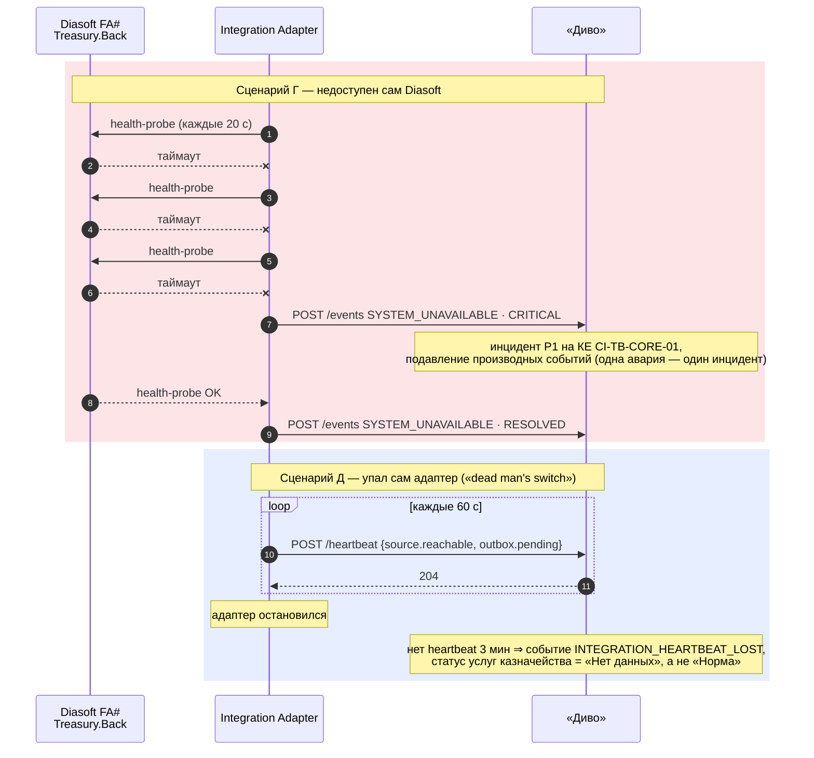
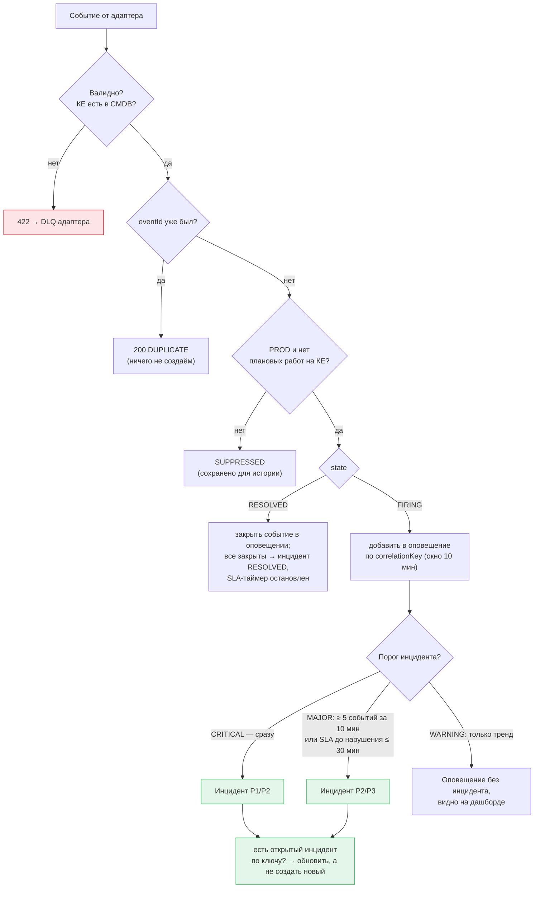

# 3. Архитектура и схема интеграции

## 3.1. Компоненты

| № | Компонент | Ответственность | Технологии (предложение) |
|---|---|---|---|
| 1 | **Diasoft FA# Treasury.Back** | источник фактов: статусы операций, журналы, задания | без доработок; read-only реплика БД |
| 2 | **Source Connectors** | опрос реплики (30 с), health-probe серверов (20 с), статусы заданий закрытия дня | Java 21 / Spring Boot или .NET 8 |
| 2 | **Rules Engine** | нормативы, SLA-календари (рабочие дни, cut-off), матрица severity, привязка к услуге и КЕ, решение «сообщать / уже сообщали» | конфигурация в YAML + справочники из CMDB |
| 2 | **Transactional Outbox** | надёжное хранение событий до подтверждения доставки | PostgreSQL |
| 2 | **Delivery Worker** | отправка, повторы с backoff, circuit breaker, лимит скорости, досылка пакетами | Resilience4j / Polly |
| 2 | **Dead Letter Queue** | события, которые нельзя доставить (ошибки данных, истёк срок 24 ч) | таблица PostgreSQL + алерт |
| 2 | **Heartbeat / Metrics** | сигнал живости 60 с, агрегаты 5 мин | планировщик адаптера |
| 3 | **API Gateway** | mTLS, OAuth2 (client credentials), лимиты, аудит вызовов | корпоративный шлюз банка |
| 4 | **«Диво» Integration API** | приём, валидация, хранение событий | веб-сервисы «Диво Сервис» |
| 4 | **Корреляция и правила** | дедупликация, группировка, подавление, пороги инцидента | правила «Диво Сервис» |
| 4 | **«Диво Сервис» — инциденты** | создание/обновление/закрытие инцидентов, SLA-таймеры, назначение групп | штатный процесс |
| 4 | **«Диво Мера»** | дашборды, отчёты по доступности и SLA | штатные дашборды |
| 4 | **«Диво Портал»** | виджет статуса казначейских услуг для бэк-офиса | конструктор портала |

## 3.2. Почему такая архитектура

1. **Адаптер между системами (anti-corruption layer).** Diasoft не знает модель «Диво», «Диво» не знает
   внутренности Diasoft. Смена версии любой из систем затрагивает только адаптер. Банк уже настраивает
   интеграции с «Диво» без изменений смежных систем — решение следует этой практике.
2. **Push по событию.** Задержка от обнаружения до инцидента — секунды, а не период опроса.
   «Диво» не тратит ресурсы на опрос сотен систем.
3. **Transactional outbox вместо «отправил и забыл».** Событие сначала надёжно сохраняется, затем отправляется.
   Недоступность «Диво» не приводит к потере событий — это главный риск простой интеграции «POST напрямую».
4. **Идемпотентность по `eventId`.** Гарантия «как минимум один раз» на транспорте + дедупликация на приёме
   = эффективно «ровно один инцидент».
5. **Пара FIRING/RESOLVED.** Инцидент закрывается автоматически, длительность сбоя для SLA — точная.
6. **Heartbeat («dead man's switch»).** Тишина ≠ норма: если адаптер упал, «Диво» об этом узнает само.
7. **REST/JSON через API Gateway.** Стандарт банка для синхронных интеграций, нативно поддерживается
   веб-сервисами «Диво Сервис», безопасность централизована в шлюзе. Брокер сообщений (Kafka) избыточен
   при ожидаемом объёме и потребовал бы от «Диво» роли потребителя — оставлен как путь развития.
8. **Read-only реплика.** Наблюдение не создаёт нагрузку на рабочую БД казначейства в часы пиковых расчётов.

## 3.3. Sequence diagram: основной сценарий

Задержка расчёта по сделке → событие → инцидент → автоматическое закрытие.

## 3.4. Sequence diagram: обработка ошибок доставки

## 3.5. Sequence diagram: недоступность Diasoft и контроль живости адаптера

## 3.6. Правила «событие → инцидент»

## 3.7. Протоколы и потоки

| Поток | Направление | Протокол | Частота |
|---|---|---|---|
| Чтение статусов операций | Адаптер → реплика Diasoft | SQL (read-only учётная запись) | 30 с |
| Проверка доступности | Адаптер → серверы Diasoft | HTTP(S) health-check / TCP | 20 с |
| События | Адаптер → API Gateway → «Диво» | HTTPS, REST/JSON, mTLS + OAuth2 | по факту |
| Досылка накопленного | Адаптер → «Диво» | HTTPS, `POST /events/batch` | после восстановления |
| Метрики | Адаптер → «Диво» | HTTPS, `POST /metrics` | 5 мин |
| Heartbeat | Адаптер → «Диво» | HTTPS, `POST /heartbeat` | 60 с |
| Справочники услуг и КЕ | «Диво» CMDB → адаптер | HTTPS, выгрузка справочника | 1 раз в сутки и по изменению |
| Алерты о проблемах интеграции | Адаптер → корпоративный мониторинг | метрики Prometheus / Zabbix | постоянно |

## 3.8. Нефункциональные требования

| Требование | Значение |
|---|---|
| Задержка «обнаружение → событие принято «Диво»» | p95 ≤ 60 с |
| Задержка «проблема → инцидент» (с учётом опроса 30 с) | ≤ 2 мин |
| Потеря событий | 0 (outbox + повторы + DLQ) |
| Пропускная способность | ≥ 50 событий/с (пик закрытия дня), пакет до 500 событий |
| Хранение событий в outbox | 7 дней после доставки (для разборов) |
| Доступность адаптера | 2 экземпляра active-standby; блокировка лидера в PostgreSQL |
| Размер события | ≤ 64 КБ |

## 3.9. Безопасность

* Взаимный TLS по сертификату адаптера от УЦ банка + OAuth2 client credentials с минимальными scope
  (`treasury.events.write`, `treasury.events.read`).
* Учётная запись Diasoft — только чтение и только нужных представлений.
* **Минимизация данных:** никаких сумм, счетов, наименований контрагентов и ПДн — только технические
  идентификаторы, статусы, класс суммы.
* Аудит всех вызовов в API Gateway, сквозной `X-Request-Id`.
* Секреты — в хранилище секретов банка, не в конфигурации.
